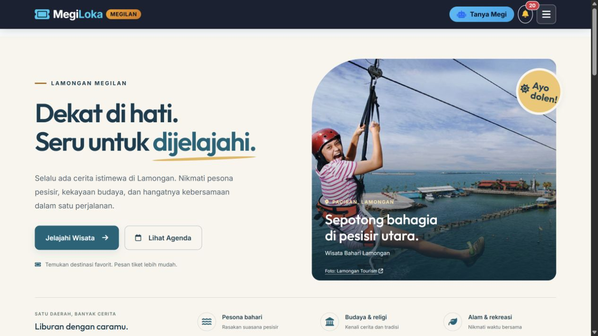

# MegiLoka

Portal wisata, reservasi tiket QR, dan pelaporan Pendapatan Asli Daerah (PAD) untuk Kabupaten Lamongan.



## Fitur

| Peran | Alur utama |
| --- | --- |
| Pengunjung | Jelajahi destinasi dan kalender wisata, tanya Megi, pesan tiket, dan lihat riwayat pesanan. |
| Kasir | Terbitkan tiket di loket, konfirmasi pembayaran reservasi, dan tukarkan kode referral yang memenuhi syarat. |
| Petugas gate | Validasi QR atau kode MGLK dari setiap tiket, termasuk deteksi pemakaian ulang. |
| Admin | Kelola destinasi, tarif, agenda, dan promo. Pantau dashboard PAD, rekap, dan ekspor CSV. |

Diskon rombongan 10% berlaku untuk minimal lima tiket dalam satu pesanan. Kasir memeriksa pembayaran tunai, QRIS, atau transfer sebelum tiket QR diterbitkan. PAD mencatat pendapatan bersih pada tanggal konfirmasi.

## Mulai di Windows

Prasyaratnya Python 3.12. Node.js diperlukan untuk pengujian antarmuka JavaScript.

```powershell
py -3.12 -m venv venv
Copy-Item .env.example .env
.\venv\Scripts\python.exe -m pip install -r backend/requirements.txt -r backend/requirements-ai-lock.txt
.\venv\Scripts\python.exe -m flask --app run:app init-db
.\venv\Scripts\python.exe run.py
```

Buka [MegiLoka lokal](http://127.0.0.1:5000/). Perintah di atas menggunakan SQLite lokal pada `backend/megiloka.db`. Untuk instalasi yang sudah ada, gunakan file `.env` yang sekarang.

### MySQL atau MariaDB

Jalankan [skrip pembuatan database](backend/database/schema.sql) melalui phpMyAdmin atau klien SQL. Setel `DB_TYPE=mysql` dan isi `DB_HOST`, `DB_PORT`, `DB_USER`, `DB_PASSWORD`, serta `DB_NAME` di `.env`. Jalankan kembali `python -m flask --app run:app init-db` dengan Python dari virtual environment.

[Model SQLAlchemy](backend/models.py) menentukan skema tabel. [Migrasi](backend/database/migrations.py) menambahkan kolom yang kurang dan menyesuaikan skema promo lama dari MySQL atau MariaDB. `init-db` bisa dijalankan ulang dan memuat katalog awal saat tabel destinasi kosong.

- Untuk data simulasi, arahkan `.env` ke database pengujian lalu jalankan `python backend/seed_demo.py`. Data ini mencakup satu transaksi dan rekap PAD contoh.
- Untuk menyalin database SQLite lama ke database tujuan yang kosong, jalankan `python backend/seed_demo.py --copy-sqlite <path>`. Simpan cadangan database sebelum pemindahan.
- Untuk menerapkan ulang profil dan tarif katalog berdasarkan kode destinasi, jalankan `python backend/destination_catalog.py`. Perintah ini menimpa informasi profil destinasi yang cocok.

### Akun petugas

Akun petugas dibuat melalui CLI. Masukkan dan konfirmasi kata sandi saat diminta. Pengunjung mendaftar melalui website.

```powershell
.\venv\Scripts\python.exe -m flask --app run:app create-staff admin --name "Administrator MegiLoka"
.\venv\Scripts\python.exe -m flask --app run:app create-staff kasir_wbl --name "Kasir WBL" --role cashier --destination DEST-WBL
.\venv\Scripts\python.exe -m flask --app run:app create-staff gate_wbl --name "Petugas Gate WBL" --role gate_keeper --destination DEST-WBL
```

Login dengan akun yang sudah tersimpan tetap menggunakan kredensial database tersebut. Instalasi baru membuat kunci aplikasi lokal di `backend/instance/` ketika `SECRET_KEY` kosong. Gunakan kunci rahasia yang tetap di server, karena penggantian kunci memengaruhi sesi dan tanda tangan QR tiket.

### Menjalankan dengan Waitress

```powershell
.\venv\Scripts\python.exe -m waitress --listen=127.0.0.1:8000 run:app
```

Jalankan `init-db` sebelum menggunakan Waitress untuk pertama kali atau setelah pembaruan skema.

## Struktur proyek

| Lokasi | Isi |
| --- | --- |
| `run.py` | Entry point Flask dan Waitress. |
| `backend/app.py`, `backend/visitor_auth.py` | Rute website, API, dan autentikasi pengunjung. |
| `backend/database/` | Setup database, migrasi, dan data referensi Lamongan. |
| `backend/models.py`, `backend/services/` | Model, perhitungan harga, QR, dan laporan PAD. |
| `backend/ai/` | Tanya Megi, data pelatihan, dan model lokal. |
| `backend/tests/` | Pengujian database, pemesanan, JavaScript, dan Tanya Megi. |
| `frontend/templates/` | Layout, komponen bersama, dan halaman publik, pengunjung, petugas, serta admin. |
| `frontend/css/`, `frontend/js/`, `frontend/images/` | Aset antarmuka. |
| `docs/`, `docs/research/` | Dokumentasi proyek dan naskah akademik. |

## Pengujian

```powershell
.\venv\Scripts\python.exe -X utf8 backend/run_tests.py
node --test backend/tests/test_chat_ui.cjs
```

Pengujian Python memakai SQLite di memori.

## Dokumentasi

- [Fitur per peran](docs/fitur-per-peran.md)
- [Panduan Tanya Megi dan pelatihan model](docs/ai/panduan-tanya-megi.md)
- [Integrasi agenda, Instagram, dan WhatsApp](docs/integrasi.md)
- [Naskah akademik LaTeX](docs/research/naskah-megiloka.tex)
- [Sumber gambar](frontend/images/SOURCES.md)

Untuk menampilkan rincian pembayaran di POS, isi `PAYMENT_BANK_DETAILS` pada konfigurasi server dan atur `PAYMENT_QRIS_IMAGE` ke nama berkas QRIS di `frontend/images`. Simpan `.env`, database lokal, dan cadangan di luar Git.

© 2026 Tim Pengembang MegiLoka.
